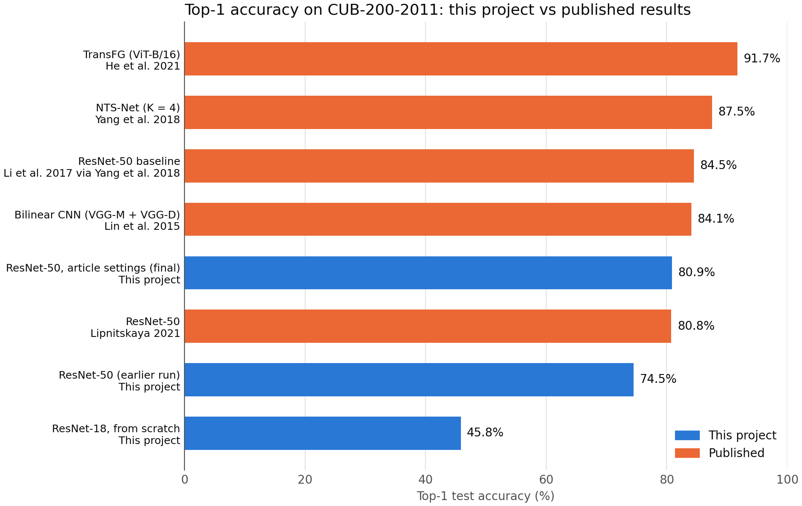

# Benchmarking against published results

We compared our classifiers with published results on CUB-200-2011, using the brief's option of comparing against results reported by others (Section 5.11). Our final model reaches 80.88% top-1 test accuracy. That matches the blog post we took its settings from and is 3.6 points below the ResNet-50 baseline commonly cited in the literature.



## Results

Our scores come from the saved files in `results/`. The chart and this table use `benchmark.csv`.

| Model | Source | Pretrained on | Image size | Training images | Top-1 test accuracy |
|---|---|---|---|---|---|
| ResNet-18, from scratch | This project | None | 224 | 5,091 | 45.84% |
| ResNet-50, earlier run | This project | ImageNet | 224 | 5,091 | 74.53% |
| **ResNet-50, article settings (final)** | **This project** | **ImageNet** | **375** | **5,091** | **80.88%** |
| ResNet-50 | Lipnitskaya, 2021 | ImageNet | 375 crop | Not confirmed | 80.77% |
| Bilinear CNN (VGG-M + VGG-D) | Lin et al., 2015 | ImageNet | 448 | Official split (count not stated) | 84.1% |
| ResNet-50 baseline | Li et al., 2017, as cited by Yang et al., 2018 | Not confirmed | Not confirmed | Not confirmed | 84.5% |
| NTS-Net (K = 4) | Yang et al., 2018 | ImageNet | 448 | 5,994 | 87.5% |
| TransFG (ViT-B/16) | He et al., 2021 | ImageNet-21k | 448 | Not confirmed | 91.7% |

## How fair the comparison is

**What matches**

- **Dataset:** all sources use CUB-200-2011 with 200 classes.
- **Test set:** ours is the unchanged 5,794-image test split, the same size Yang et al. report.
- **Metric:** all scores are top-1 accuracy. We don't compare precision, recall or F1 here because these sources don't report them for this comparison.

**What differs**

- **Training images:** we train on 5,091 images, because 899 are held out for validation and 4 duplicates were removed. Yang et al. train on all 5,994.
- **Image size:** we use 375 x 375. Lin et al., Yang et al. and He et al. use 448 x 448 in their own methods.
- **Evaluation run:** our score comes from one training run. The test set's margin of error is about ±1 point, so the 0.11-point gap to Lipnitskaya (2021) isn't meaningful.

## Why the scores differ

**Against ResNet-50, the fairest comparison.** Our model is 3.6 points below the 84.5% baseline, and it has the same architecture. Likely causes are fewer training images, smaller images, and different cropping and training settings. We didn't test these one at a time, so we can't say how much each one contributes. We also couldn't confirm the baseline's image size.

**Against our earlier ResNet-50.** The final model gains 6.35 points with the same architecture and pretrained weights. Image size, cropping, optimizer, learning rate schedule, weight decay, label smoothing, batch size and epochs all changed together, so this gain can't be credited to one change.

**Against the higher-scoring methods.** These add more than a standard classifier:

- **Bilinear CNN** combines features from two networks to capture finer differences.
- **NTS-Net** finds the most informative image regions and uses them alongside the full image.
- **TransFG** uses a vision transformer that selects discriminative image patches and adds a contrastive loss.

**Against our from-scratch model.** ResNet-18 from scratch reaches 45.84%, far below every pretrained result listed. This table can't separate the effect of pretraining from the effect of the larger network. It's included for context and isn't a fair match for the published methods.

## Limitations

- **Published numbers are compared as reported.** We didn't rerun these models ourselves.
- **One source isn't peer-reviewed.** Lipnitskaya (2021) is a blog post, and we didn't confirm its train and test split.
- **"Not confirmed" means not stated in the material we checked.** It doesn't mean the value is unusual.
- **The final score should match the final checkpoint.** If the retrained model becomes the final model, update its row in `benchmark.csv`, this file, and the chart.

To redraw the chart after changing `benchmark.csv`:

```bash
python -m src.visualization.benchmark_chart
```

## References

- Lin, T.-Y., RoyChowdhury, A., Maji, S. Bilinear CNN Models for Fine-Grained Visual Recognition. ICCV 2015; extended version: [arXiv:1504.07889](https://arxiv.org/abs/1504.07889).
- Li, Z., Yang, Y., Liu, X., Zhou, F., Wen, S., Xu, W. Dynamic Computational Time for Visual Attention. ICCV 2017.
- Yang, Z., Luo, T., Wang, D., Hu, Z., Gao, J., Wang, L. Learning to Navigate for Fine-grained Classification. ECCV 2018; [arXiv:1809.00287](https://arxiv.org/abs/1809.00287).
- He, J., Chen, J.-N., Liu, S., Kortylewski, A., Yang, C., Bai, Y., Wang, C. TransFG: A Transformer Architecture for Fine-grained Recognition. [arXiv:2103.07976](https://arxiv.org/abs/2103.07976).
- Lipnitskaya, S. [Bird by Bird using Deep Learning](https://medium.com/data-science/bird-by-bird-using-deep-learning-4c0fa81365d7). 2021.
